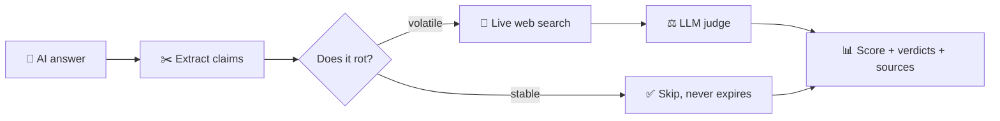
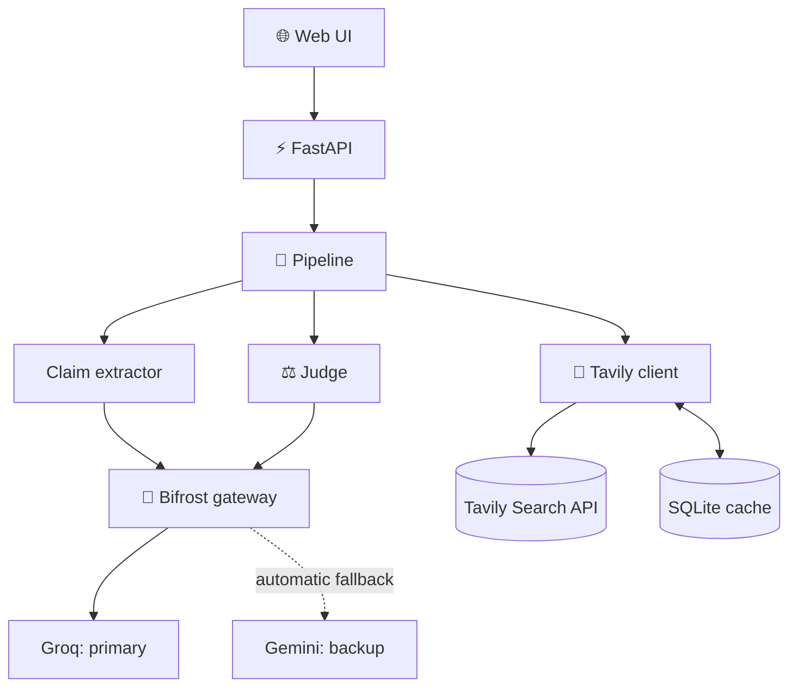

<div align="center">


### AI answers go stale. This finds the rotten bits.

<p>
  
  
  
  
  
</p>

<p>
  <a href="#-the-problem">Problem</a> ·
  <a href="#-how-it-works">How it works</a> ·
  <a href="#-the-expiry-table">Expiry table</a> ·
  <a href="#-the-freshness-score">Score</a> ·
  <a href="#-architecture">Architecture</a> ·
  <a href="#-run-it">Run it</a> ·
  <a href="#-roadmap">Roadmap</a>
</p>

</div>

---

## 🧂 The problem

You ask an AI: *"How much is Notion Plus?"*

It answers fast and sounds sure. But its knowledge is frozen in the past.

```text
AI says   →  "Notion Plus costs $5 per month."          ← sounded sure
Reality   →  Notion Plus is $10 per seat / month.        ← checked live
Verdict   →  🔴 STALE  (pricing facts expire in 1 day)
```

Nobody marks which sentences in an answer are risky. **BestBeforeRot does.**

> Think of it like a food label. Milk spoils in days. Salt lasts years.
> Facts work the same way. A price spoils fast. "The Eiffel Tower is in Paris" never does.

---

## 🔬 How it works

Paste any AI answer. The engine does five things:

| # | Step | What happens |
|---|------|--------------|
| 1 | **Split** | An LLM breaks the answer into small, checkable claims |
| 2 | **Label** | Each claim gets a type (pricing, version, law...) and an expiry time |
| 3 | **Skip** | Stable facts are not searched. They don't rot. |
| 4 | **Check** | Fast-rotting claims are searched live and judged against fresh evidence |
| 5 | **Score** | You get a freshness score, a verdict per claim and real source links |



---

## ⏳ The expiry table

Each claim type has a time-to-live (TTL). This is the core idea of the project.

| Claim type | Example | Expires after | Speed |
|------------|---------|:-------------:|:-----:|
| 💸 `pricing` | "Plus plan costs $10/month" | **1 day** | 🔥 fast |
| 🏷️ `version` | "Latest release is v4.2" | **7 days** | 🔥 fast |
| 👔 `leadership` | "The CEO is Sam Altman" | **30 days** | 🐢 slow |
| ⚖️ `law` | "This rule is in force" | **30 days** | 🐢 slow |
| 🎲 `other` | anything else that can change | **7 days** | 🐢 slow |
| 🗿 `stable` | "The Eiffel Tower is in Paris" | **never** | ♾️ none |

All TTLs live in one file (`app/ttl.py`). One source of truth.

---

## 📊 The freshness score

Every checked claim gets a verdict. The verdicts combine into one score from 0 to 100.

| Verdict | Points |
|---------|--------|
| 🟢 **fresh** | `80 + 10 × confidence`, plus 10 if 2 or more independent sources agree |
| 🔴 **stale** | `15` |
| ⚪ **unverifiable** | `40` |

Fast-rotting claims count **1.5×**. Slow ones count **1.0×**. Stable claims are ignored.

```text
 0 ───────────── 49 │ 50 ──────── 79 │ 80 ─────────── 100
        🔴 RISKY          🟡 MIXED            🟢 FRESH
```

If search fails, the claim becomes `unverifiable`. The request never crashes.

---

## 🏗️ Architecture



**Why it's built this way**

- 🚪 **Bifrost gateway.** One door to all models. If the primary model fails, Bifrost switches to the fallback by itself.
- 🗃️ **SQLite cache.** Search results are cached for 6 hours. The second identical search took **1 ms** instead of about 2.5 s in our test run.
- 🔒 **Frozen contracts.** All data shapes are Pydantic models. No loose dicts.
- 🧱 **Small files, one job each.** Easy to read, easy to test.

---

## 🧰 Tech stack

| Layer | Tool |
|-------|------|
| API | FastAPI + Uvicorn |
| Data models | Pydantic v2 |
| LLM gateway | Bifrost |
| Primary model | Groq `gpt-oss-120b` |
| Fallback model | Gemini `3.5-flash-lite` |
| Web search | Tavily |
| Cache | SQLite |
| Tests | pytest, respx (HTTP mocks) |

---

## 📁 Project layout

```text
BestBeforeRot/
├── app/
│   ├── main.py              # FastAPI app + /api/health
│   ├── config.py            # settings from .env
│   ├── models.py            # frozen Pydantic contracts
│   ├── ttl.py               # the expiry table
│   ├── prompts.py           # claim + judge prompts
│   ├── pipeline.py          # the full verify flow
│   └── services/
│       ├── bifrost_client.py
│       ├── tavily_client.py
│       ├── claims.py
│       ├── judge.py
│       └── scoring.py
├── web/                     # frontend
├── scripts/                 # small CLI runners for each phase
├── tests/                   # unit tests
└── docs/                    # PRD, architecture, rules, design, tasks, memory
```

---

## 🚀 Run it

**You need:** Python 3.10+, Node.js (for Bifrost), a free [Groq](https://console.groq.com/keys) key, a free [Gemini](https://aistudio.google.com/app/apikey) key and a free [Tavily](https://tavily.com) key.

```bash
# 1. clone
git clone https://github.com/manishchandraraturi/BestBeforeRot.git
cd BestBeforeRot

# 2. install
pip install -r requirements.txt

# 3. config
cp .env.example .env        # then fill in your models and TAVILY_API_KEY

# 4. start the gateway (new terminal), then add Groq + Gemini keys at http://localhost:8080
npx -y @maximhq/bifrost

# 5. start the app
uvicorn app.main:app --port 8000
```

Check it's alive:

```bash
curl localhost:8000/api/health
# {"ok":true,"bifrost":true,"tavily_key_set":true}
```

Try the pieces on their own:

```bash
python -m scripts.try_bifrost "Say hello"
python -m scripts.try_tavily "Notion Plus plan price per month"
python -m scripts.try_claims "The Notion Plus plan costs $10 per month."
pytest -q
```

<details>
<summary><b>⚙️ Environment variables</b></summary>

| Variable | Default | Meaning |
|----------|---------|---------|
| `BIFROST_URL` | `http://localhost:8080` | Gateway address |
| `PRIMARY_MODEL` | none | Main model, for example `groq/...` |
| `FALLBACK_MODEL` | none | Backup model, for example `gemini/...` |
| `WEAK_MODEL` | none | Cheaper model for claim extraction |
| `TAVILY_API_KEY` | none | Search key |
| `MAX_CLAIMS` | `8` | Max claims checked per answer |
| `MAX_PARALLEL` | `4` | Parallel searches |
| `REQUEST_TIMEOUT_S` | `25` | Per-request timeout |
| `CACHE_DB` | `ttl_cache.db` | SQLite file |

Never commit `.env`. It's already in `.gitignore`.

</details>

---

## 🗺️ Roadmap

Built one phase at a time. Each phase has a test gate that must pass.

| Phase | What | Status |
|:-----:|------|:------:|
| P0 | Repo, docs, config | ✅ Done |
| P1 | Skeleton, models, TTL table, health endpoint | ✅ Done |
| P2 | Bifrost client with automatic fallback | ✅ Done |
| P3 | Tavily client with 6-hour cache | ✅ Done |
| P4 | Claim extraction | ✅ Done |
| P5 | Verify pipeline: search + judge + score | 🔨 Building |
| P6 | Verify API endpoint + full cache | ⏳ Next |
| P7+ | Web UI, corrected-answer rewrite, polish | ⏳ Planned |

---

## 🧪 Honest limits

- Tavily's basic search returns **no publish dates**, so the judge works from content, not dates.
- Free model tiers can be slow. The fallback hop took about 6 to 7 s in our tests.
- A verdict is only as good as the evidence found. A bad search gives an `unverifiable` result, never a made-up one.

---

<div align="center">

**Built by [Manish Chandra Raturi](https://github.com/manishchandraraturi)**

*Because "sounds right" is not the same as "is still right."*


</div>
