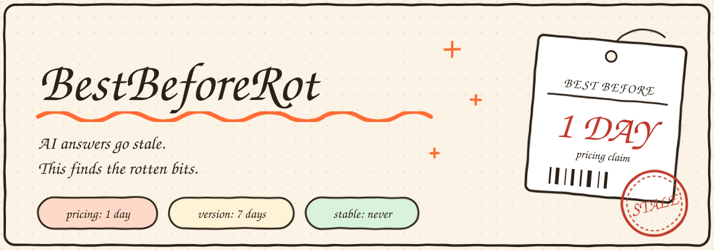
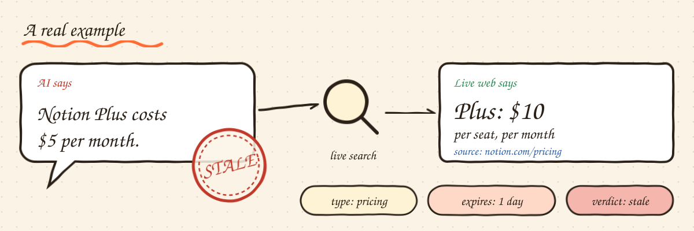
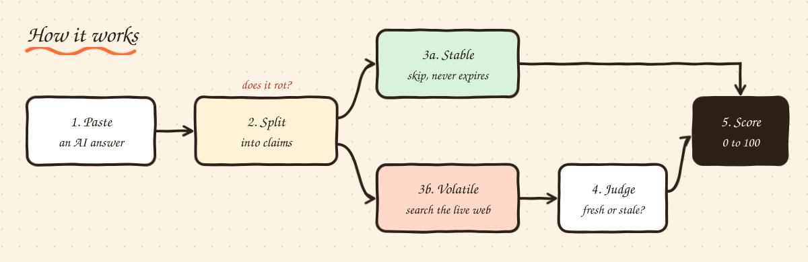
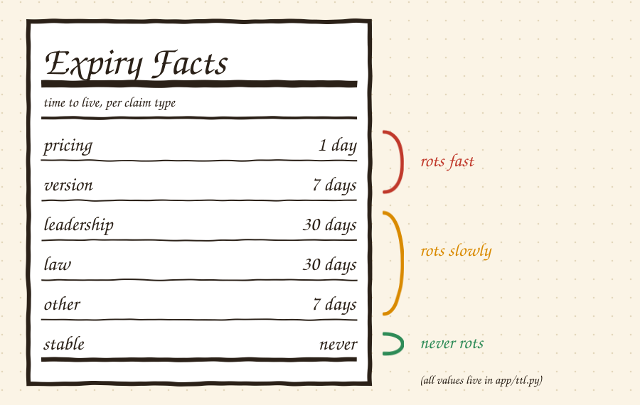
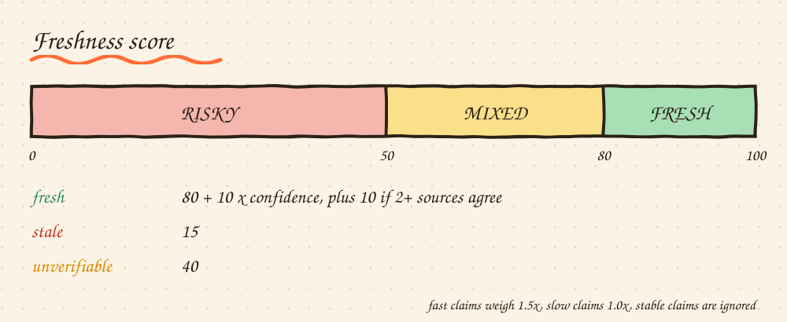
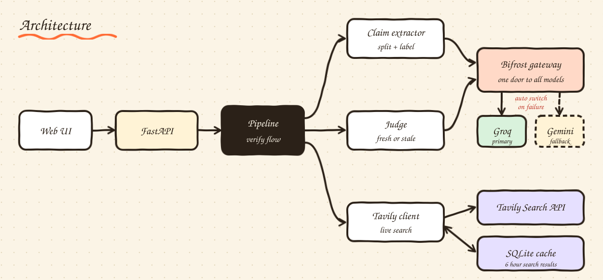
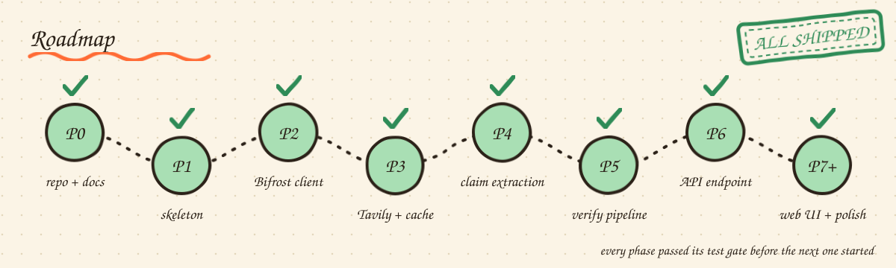

<div align="center">



<br/>


<br/><br/>

**An AI says "Notion Plus costs $5 a month." Is that still true today?**<br/>
BestBeforeRot reads any AI answer, finds the claims that can go bad, and checks them against the live web.

</div>

<br/>

## The problem

Language models learn once, then keep answering for years. Prices change. Versions ship. CEOs leave. The answer still sounds just as sure.



Nothing in a normal AI answer tells you which sentences are risky. This project adds that missing label.

Think of food. Milk spoils in days. Salt lasts for years. Facts behave the same way, so every claim gets its own **best before** date.

<br/>

## How it works



1. **Split.** An LLM breaks the answer into small, checkable claims.
2. **Label.** Each claim gets a type (pricing, version, law...) and an expiry time.
3. **Skip.** Stable facts are never searched. They do not rot.
4. **Check.** Fast-rotting claims are searched live, and a judge compares them with fresh evidence.
5. **Score.** You get a verdict per claim, real source links and one overall score.

<br/>

## The expiry table

This is the core idea. Different facts rot at different speeds.

<div align="center">

</div>

<br/>

## The freshness score



If search fails for a claim, it becomes `unverifiable`. The whole request never crashes.

<br/>

## Architecture



Why it is built this way:

- **Bifrost gateway.** One door to every model. If the primary model fails, it switches to the fallback by itself.
- **SQLite cache.** Search results are kept for 6 hours. In a real test run, the repeat search took 1 ms instead of about 2.5 s.
- **Frozen contracts.** Every data shape is a Pydantic model. No loose dictionaries.
- **Small files.** One job per file, so everything is easy to read and test.

<br/>

## Tech stack

| Layer | Tool |
|-------|------|
| API | FastAPI, Uvicorn |
| Data models | Pydantic v2 |
| LLM gateway | Bifrost |
| Primary model | Groq `gpt-oss-120b` |
| Fallback model | Gemini `3.5-flash-lite` |
| Web search | Tavily |
| Cache | SQLite |
| Tests | pytest, respx |

<br/>

## Project layout

```text
BestBeforeRot/
├── app/
│   ├── main.py            FastAPI app and /api/health
│   ├── config.py          settings from .env
│   ├── models.py          frozen Pydantic contracts
│   ├── ttl.py             the expiry table
│   ├── prompts.py         claim and judge prompts
│   ├── pipeline.py        the full verify flow
│   └── services/
│       ├── bifrost_client.py
│       ├── tavily_client.py
│       ├── claims.py
│       ├── judge.py
│       └── scoring.py
├── web/                   frontend
├── scripts/               small CLI runner for each phase
├── tests/                 unit tests
├── assets/                README art
└── docs/                  PRD, architecture, rules, design, tasks, memory
```

<br/>

## Run it

You need Python 3.10+, Node.js (for Bifrost) and free keys for [Groq](https://console.groq.com/keys), [Gemini](https://aistudio.google.com/app/apikey) and [Tavily](https://tavily.com).

```bash
git clone https://github.com/manishchandraraturi/BestBeforeRot.git
cd BestBeforeRot
pip install -r requirements.txt

cp .env.example .env          # fill in your models and TAVILY_API_KEY

npx -y @maximhq/bifrost       # new terminal, then add Groq and Gemini keys at localhost:8080

uvicorn app.main:app --port 8000
```

Check that it is alive:

```bash
curl localhost:8000/api/health
# {"ok":true,"bifrost":true,"tavily_key_set":true}
```

Try each piece on its own:

```bash
python -m scripts.try_bifrost "Say hello"
python -m scripts.try_tavily "Notion Plus plan price per month"
python -m scripts.try_claims "The Notion Plus plan costs $10 per month."
pytest -q
```

<details>
<summary><b>Environment variables</b></summary>

<br/>

| Variable | Default | Meaning |
|----------|---------|---------|
| `BIFROST_URL` | `http://localhost:8080` | Gateway address |
| `PRIMARY_MODEL` | none | Main model, for example `groq/...` |
| `FALLBACK_MODEL` | none | Backup model, for example `gemini/...` |
| `WEAK_MODEL` | none | Cheaper model for claim extraction |
| `TAVILY_API_KEY` | none | Search key |
| `MAX_CLAIMS` | `8` | Max claims checked per answer |
| `MAX_PARALLEL` | `4` | Parallel searches |
| `REQUEST_TIMEOUT_S` | `25` | Per-request timeout |
| `CACHE_DB` | `ttl_cache.db` | SQLite file |

Never commit `.env`. It is already in `.gitignore`.

</details>

<br/>

## Roadmap

Built one phase at a time. Every phase has a test gate that must pass before the next one starts.



<br/>

## Honest limits

- Tavily basic search returns no publish dates, so the judge works from page content, not dates.
- Free model tiers can be slow. The fallback hop took about 6 to 7 seconds in testing.
- A verdict is only as good as the evidence found. If search fails, you get `unverifiable`, never a made-up answer.

<br/>

<div align="center">

Built by [Manish Chandra Raturi](https://github.com/manishchandraraturi)

*"Sounds right" is not the same as "is still right."*

</div>
