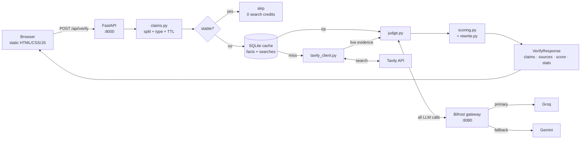

<div align="center">


<br/>


<br/><br/>

### Your AI answer has an expiry date. Most of it already passed.

BestBeforeRot sits between an LLM answer and the person reading it: it splits the answer into
claims, gives every claim its own **best-before date**, searches only the ones that can rot,
and returns a corrected answer with live sources attached.

<br/>

`paste an answer` → `stale claims struck through` → `corrected text + sources` → `freshness score`

</div>

<br/>

## The problem

A language model learns once and then keeps answering for years. Prices change, versions ship,
CEOs leave, laws get amended — and the answer still sounds exactly as confident as it did on day one.

> "The Notion Plus plan costs **$5** per month. Jack Dorsey is the CEO of Twitter."

Both sentences are wrong today. Neither one *looks* wrong. Users have no way to tell which line
of an AI answer has gone bad, so the only options are "trust all of it" or "check all of it".

The usual fix — "search the web for every sentence" — is slow and burns search credits on facts
that never change. "The Eiffel Tower is in Paris" does not need a Tavily credit.

<br/>

## The solution

**Every fact gets an expiry date, and search is spent only where facts can rot.**

1. **Split** — an LLM breaks the answer into small, checkable claims.
2. **Label** — each claim gets a type (`pricing`, `version`, `leadership`, `law`, `stable`, `other`) and a TTL.
3. **Skip** — `stable` claims are never searched. They do not rot.
4. **Check** — volatile claims get a live Tavily search, and a judge model compares the claim to that evidence only.
5. **Judge** — `fresh`, `stale` or `unverifiable`. No evidence means *can't verify*, never a guess.
6. **Fix & score** — stale claims are rewritten in place with sources, and every claim gets a 0–100 freshness score.
7. **Remember** — the verdict is cached until *its own* TTL runs out, so asking again is instant.

### The expiry table

| Claim type | Rot speed | TTL |
|---|---|---|
| `pricing` | fast | 1 day |
| `version` | fast | 7 days |
| `leadership` | slow | 30 days |
| `law` | slow | 30 days |
| `other` | slow | 7 days |
| `stable` | never | never searched |

That table is the whole product thesis: expiry is a property of the *claim type*, not of the answer.

<br/>

## How it uses Tavily

Tavily is the only source of truth. The judge never sees the model's memory — it sees the claim and
up to five live results, with the URLs it is allowed to cite.

- `POST https://api.tavily.com/search`, `search_depth: "basic"` (1 credit), `max_results: 5`.
- The query is written per claim by the extraction step (e.g. `Notion Plus plan price per month 2026`).
- Evidence kept per result: `title`, `url`, `content` (trimmed to ~600 chars), `published_date` if present, `score`.
- Search responses are cached for 6 hours by query; judged facts are cached for their TTL.
- Every cited source is validated against the returned evidence — the judge cannot invent a URL.
- Search failure for one claim marks that claim `unverifiable`; the request still returns HTTP 200.

<br/>

## How it uses Bifrost

Every model call goes through the Bifrost gateway (`http://localhost:8080`, OpenAI-compatible).
The app never holds a provider key.

- **Routing** — one base URL, model strings like `groq/openai/gpt-oss-120b` and `gemini/gemini-3.5-flash-lite`.
- **Fallback** — if the primary provider fails, Bifrost fails over; `fallback_triggered` and the
  provider that actually answered are returned in `stats` and shown as a badge in the UI.
- **Simulated outage** — the demo's *Simulate outage* toggle sends a deliberately invalid primary
  model so the fallback path can be shown live, without touching real keys.
- **Cost tracking** — token counts (`tokens_in`, `tokens_out`), `llm_calls` and `providers_used`
  come from the gateway response and are surfaced in the stats strip.

<br/>

## Architecture



**Rules that keep the bug count low:** one contract file (`app/models.py`), LLM decides meaning and
code decides numbers, every model reply is parsed through Pydantic with one repair retry, and one
broken claim can never fail the request.

<br/>

## Benchmark

40 hand-labelled claims — 15 stale, 15 fresh, 10 unverifiable — each sent through the real pipeline
one at a time with the cache **off**, against a bench-local database deleted before the run, so every
verdict came from a live Tavily search and a live judge call. Labels were fixed from official sources
before the run.

| Metric | Value |
|---|---|
| Claims tested | 40 (15 stale · 15 fresh · 10 unverifiable) |
| Stale recall | 14/15 (93.3%) |
| Stale precision | 14/16 (87.5%) |
| False-alarm rate | 0/15 fresh claims called stale (0.0%) |
| Unverifiable handling | 7/10 said "can't verify" (70.0%) |
| Fresh claims confirmed | 14/15 (93.3%) |
| Claim-level accuracy | 87.5% |
| Tavily credits used | 38 |
| "Search everything" baseline | 40 credits (1 per claim) |
| Search credits saved | 5.0% (2 of 40) |
| Avg latency per claim (cold) | 4.4 s (median 3.2 s) |
| Claims skipped as stable | 2 |
| Pipeline errors | 0 |

Full per-claim table, confusion matrix and every miss: [`bench/results.md`](bench/results.md).

**Reading these numbers honestly.** Zero false alarms on 15 fresh claims is the number that matters
most for trust, and 14/15 stale recall is the one the demo lives on. The 5% credit saving is low
*by construction*: every benchmark sentence is volatile, so volatility gating had almost nothing to
skip. On a normal mixed answer the demo searches 2 of 3 claims. Two misses were `unverifiable`
claims that search "corrected" against real, same-named entities — an honest cost of evidence-only
judging.

<br/>

## Run it locally

You need Python 3.11+, Node.js (for Bifrost), and free keys for
[Groq](https://console.groq.com/keys), [Gemini](https://aistudio.google.com/app/apikey) and [Tavily](https://tavily.com).

```bash
# 1 · clone + install
git clone https://github.com/manishchandraraturi/BestBeforeRot.git
cd BestBeforeRot
python -m venv .venv && source .venv/bin/activate      # Windows: .venv\Scripts\activate
pip install -r requirements.txt

# 2 · configure
cp .env.example .env
#   TAVILY_API_KEY=tvly-...
#   PRIMARY_MODEL=groq/<model>   FALLBACK_MODEL=gemini/<model>   WEAK_MODEL=groq/<small-model>
#   (model ids change often — copy the current ones from each provider's free list)

# 3 · start the gateway (terminal 2)
npx -y @maximhq/bifrost
#   open http://localhost:8080 → add the Groq and Gemini provider keys there (never in .env)

# 4 · start the app (terminal 1)
uvicorn app.main:app --port 8000
#   open http://127.0.0.1:8000
```

Sanity check:

```bash
curl http://127.0.0.1:8000/api/health
# {"ok":true,"bifrost":true,"tavily_key_set":true}
```

> On some Windows setups `localhost` resolves to IPv6 only while uvicorn listens on IPv4 —
> use `127.0.0.1` in the URL bar and in `curl` if `localhost` refuses to connect.

### Try the API

```bash
curl -X POST http://127.0.0.1:8000/api/verify \
  -H "Content-Type: application/json" \
  -d '{"answer":"The Notion Plus plan costs $5 per month."}'
```

```jsonc
{
  "overall_score": 15,               // 15 = stale claim, code-computed
  "overall_band": "risky",
  "corrected_answer": "The Notion Plus plan costs $10 per member per month (billed annually).",
  "claims": [{
    "text": "The Notion Plus plan costs $5 per month.",
    "type": "pricing",
    "volatility": "fast",
    "ttl_days": 1,
    "verdict": "stale",
    "corrected_text": "The Notion Plus plan costs $10 per member per month (billed annually).",
    "confidence": 0.99,
    "sources": [{ "title": "Notion Pricing", "url": "https://www.notion.com/pricing" }],
    "expires_at": "2026-11-23T10:24:00+00:00"
  }],
  "stats": { "claims_searched": 1, "cache_hits": 0, "tavily_credits_used": 1, "latency_ms": 6615 }
}
```

Other routes: `POST /api/ask` (weak model writes the answer, then verification runs),
`GET /api/samples`, `GET /api/cache`, `DELETE /api/cache` (demo reset), `GET /docs` (FastAPI schema).

### Reproduce the benchmark

```bash
python bench/run_bench.py      # ≈4 min, 40 Tavily credits, writes bench/results.md
pytest -q                      # 74 unit tests, no network
```

<br/>

## Project layout

```text
BestBeforeRot/
├── app/
│   ├── main.py            FastAPI app, /api/* routes, static mount
│   ├── config.py          settings from .env
│   ├── models.py          frozen Pydantic contracts
│   ├── ttl.py             the expiry table
│   ├── prompts.py         claim + judge prompts
│   ├── pipeline.py        extract → cache → search → judge → score → rewrite
│   └── services/
│       ├── bifrost_client.py   chat() → text, tokens, provider, fallback flag
│       ├── tavily_client.py    search() → evidence, 6h query cache
│       ├── claims.py           claim extraction
│       ├── judge.py            evidence-locked verdicts
│       ├── scoring.py          deterministic 0–100
│       ├── rewrite.py          corrected answer
│       └── cache.py            per-fact TTL cache (SQLite)
├── web/                   index.html · styles.css · app.js (no build step)
├── bench/                 claims.jsonl · run_bench.py · results.md
├── scripts/               one CLI per service, for manual checks
├── tests/                 74 pytest tests
├── assets/                README art
└── docs/                  PRD, architecture, rules, design, tasks, memory, deck
```

<br/>

## Tech stack

| Layer | Choice |
|---|---|
| API | FastAPI + Uvicorn |
| Contracts | Pydantic v2 |
| LLM gateway | **Bifrost** (`npx -y @maximhq/bifrost`) |
| Models | Groq `gpt-oss-120b` (primary) · Gemini `3.5-flash-lite` (fallback) · Groq `gpt-oss-20b` (extraction) |
| Search | **Tavily** (`search_depth: basic`) |
| Storage | SQLite (stdlib `sqlite3`) |
| Frontend | Plain HTML + CSS + vanilla JS, no bundler |
| Tests | pytest + pytest-asyncio + respx |

<br/>

## AI usage

The project was built agentically and the AI usage is part of the honest record:

- **Freebuff coding agent** implemented every phase — backend services, the UI, the benchmark,
  the docs — file by file, with a test gate after each phase.
- **DeepSeek** was used to draft the per-phase build prompts from the PRD/architecture docs.
- **Groq + Gemini via Bifrost** are the runtime models: claim extraction, judging and answer
  rewriting. The judge is deliberately restricted to Tavily evidence; its own memory is off-limits.
- The 40 benchmark labels were **set by hand** from the official source URLs, not generated by a model.
- Every number in this README comes from `bench/results.md`, generated by a real run.

<br/>

## Limitations

- **No publish dates from basic Tavily search.** `search_depth: "basic"` returns no `published_date`
  on the results we measured, so every `Source.published` is `null` and the judge works from page
  *content* (which usually states the current value) rather than from a document date. Fixing it
  needs `topic: "news"` / `time_range`, which the frozen search body does not allow yet.
- **Free tiers are slow.** A fallback hop to Gemini cost ~6–7 s in testing, and the benchmark's
  worst claim took 29.5 s. The per-request timeout is 25 s.
- **Verdicts are evidence-bound.** If search finds nothing useful, the claim is `unverifiable` —
  correct behaviour, but it means a true-but-obscure fact is never confirmed.
- **Fixed historical dates look `stable`.** A sentence like "the AI Act became applicable on
  2 August 2026" is typed `stable` and skipped, because under this product's model a permanent
  date never rots. Volatile *rules* are still checked.
- **Single-tenant, local-first.** No auth, no multi-user cache partitioning, no deployment; SQLite
  is the datastore by design for a two-day build.
- **Benchmark size.** 40 claims is enough to show the shape of the behaviour, not enough for
  statistical confidence. The labels and prompts are frozen as of this run.

<br/>

<div align="center">

Built by [Manish Chandra Raturi](https://github.com/manishchandraraturi) for the **Global AI Hackathon 2026** · Problem Statement 06 (Tavily) · uses **Tavily** + **Bifrost**.

*"Sounds right" is not the same as "is still right."*

</div>
